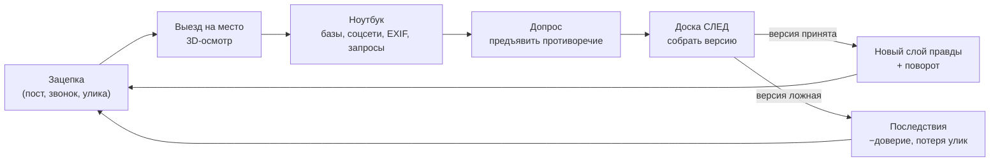
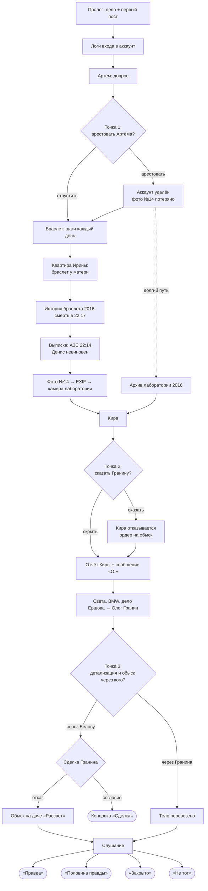

# «Была в сети» — Game Design Document

**Жанр:** true crime, детектив от первого лица · **Движок:** Unreal Engine 5.6+ · **Платформа:** PC (Windows)
**Длительность:** 3–4 часа (полная игра), 20–30 минут (прототип) · **Бюджет:** 0 ₽, только бесплатные ресурсы
**Цель:** игра для Twitch-стрима; после прохождения бесплатный релиз (itch.io / VK Play)

Сюжет, правда о деле и все улики собраны в [CASE_BIBLE.md](CASE_BIBLE.md).

---

## 1. Питч

> Десять лет назад в провинциальном Северогорске пропала 19-летняя Алина. Её парень сидит за убийство.
> Неделю назад её аккаунт снова вышел в сеть.

Вы следователь, которому поручили «быстро закрыть» проверку по апелляции. Вы осматриваете места преступления в 3D,
реконструируете ночь 14 октября 2016 года и раскрываете дело через служебный ноутбук: полицейские базы, соцсети,
метаданные фото, данные фитнес-браслета, детализацию звонков. Чем глубже вы копаете, тем ближе к собственному
наставнику.

**Уникальные фишки:**
1. **Мёртвая девушка пишет в соцсети прямо во время игры:** посты приходят в реальном времени, даже посреди допроса.
2. **Доска «СЛЕД» на компьютере:** связи между уликами тянутся мышкой, а ложные версии логически цельные.
3. **Чат решает:** в ключевые моменты Twitch-чат голосует, стример решает, послушать ли его.
4. **Ошибки необратимы:** три точки невозврата и пять концовок.

---

## 2. Столпы дизайна

1. **Честность.** Каждую разгадку можно найти логикой. Никаких «пиксель-хантинга» и решений «наугад».
2. **Каждые 10–15 минут поворот.** Стрим не должен провисать.
3. **Чат — соучастник.** Есть моменты, где хочется спросить зрителей «что думаете?».
4. **Достоверность.** Настоящие процедуры, бюрократия, провинция. Никакой голливудской «магии» в экспертизах.

---

## 3. Core loop

**Ресурс «Доверие начальства»** (0–100, старт 60). Тратится на неверные версии, лишние запросы и грубые допросы.
При 0 Гранин забирает дело, и это концовка «Закрыто». Ресурс держит игрока в напряжении, но не наказывает за исследование.

---

## 4. Механики

### 4.1. Осмотр мест (3D, от первого лица)
- 5 локаций: отдел полиции, квартира Ирины, набережная + лодочная станция «Волна», кафе «Причал», дача «Рассвет».
- Подсветка интерактивных предметов **мягкая** (видна при наведении), чтобы не было пиксель-хантинга.
- Предмет можно взять и **покрутить в руках** (3D-осмотр), найти деталь (номер, пятно, гравировку).
- **Фото на служебный телефон:** снимок попадает в ноутбук как улика.

### 4.2. Реконструкция 2016 года
- На месте преступления включается режим «2016»: VHS-шум, холодный цвет, дождь.
- Манекены-силуэты персонажей стоят в позах. Игрок двигает **ползунок времени** (21:00 → 23:45),
  и силуэты перемещаются по известным фактам.
- Задача: поставить недостающий силуэт в правильное место и время («где Денис в 22:14?»).
  Если ответ верный, реконструкция «защёлкивается» и становится уликой на доске.
- Дёшево в производстве: манекены, позы, а не анимации.

### 4.3. Служебный ноутбук
Работает как настоящая медленная госсистема: серые окна, «ВНИМАНИЕ: доступ логируется», иногда «подождите…».

| Приложение | Что делает |
|---|---|
| **ИБД «Розыск»** | Поиск людей, авто, адресов, судимостей. Запросы стоят времени |
| **Материалы дела** | Отсканированные протоколы 2016 года, фото, видео допроса |
| **«Круг»** (соцсеть) | Профиль Алины и других, лента, геотеги, комментарии. Новые посты приходят в реальном времени |
| **Почта / СЭД** | Задания от Гранина, ответы на запросы (операторы, банки, Росреестр) |
| **Фотоэксперт** | Метаданные (EXIF): дата, геотег, камера, серийный номер. Увеличение деталей |
| **Связь** | Детализации звонков и вышки на карте города |
| **«СЛЕД»** | Доска расследования (ниже) |

### 4.4. Доска «СЛЕД»
- Карточки: **люди, места, улики, события, утверждения** (из допросов).
- Игрок **тянет нить** от карточки к карточке и выбирает тип связи: *был в, владеет, лжёт о, совпадает по времени, противоречит, видел*.
- Набор связей складывается в **версию-предложение**, например «[Денис] был в [АЗС] в [22:14], потому что [банковская выписка]».
- Кнопка **«Доложить версию»**: правильная версия «защёлкивается» с эффектом и открывает следующий слой,
  неправильная стоит доверия, а **логически цельная ложная** версия принимается и бьёт последствиями позже.
- Технически это граф: узлы и рёбра в Data Tables, проверка через C++ (`UDeductionSubsystem`).

### 4.5. Допросы
- Персонаж говорит **утверждения** (каждое — отдельная карточка).
- В любой момент можно **«Предъявить»** улику из ноутбука против конкретного утверждения.
- Верное предъявление: персонаж ломается, появляется новое утверждение, иногда признание.
  Неверное: −доверие, персонаж закрывается по этой теме.
- Озвучка + анимация лица MetaHuman по аудио. Реплики игрока идут только текстом.

### 4.6. Точки невозврата и голосования чата
Три точки невозврата (см. библию дела, §7). В каждой:
1. Игра ставит паузу и показывает выбор крупно, с безопасной зоной под камеру стримера.
2. Если включена интеграция с Twitch, чат голосует 60 секунд (`1` / `2` в чат), полоса результатов на экране.
3. Стример может согласиться с чатом или пойти против (это отдельная реакция в игре: «Чат не одобряет»).

Плюс 3–4 **мягких голосования** без последствий: кого допросить первым, куда ехать.

### 4.7. Финал: слушание по апелляции
Судья задаёт 6 вопросов (библия дела, §6). На каждый игрок предъявляет улику или версию.
Число верных ответов плюс решения в точках невозврата определяют концовку (§8 библии).

---

## 5. Структура игры

| Акт | Время | Содержание | Поворот в конце |
|---|---|---|---|
| **Пролог** | 10 мин | Отдел, Гранин отдаёт дело: «Закрой за неделю». Ноутбук, первый пост Алины | Новый пост приходит прямо при игроке |
| **1. «Взломщик»** | 35 мин | Логи входа, Артём, мастерская, допрос | Пост №4 во время допроса. **Точка №1** |
| **2. «Она жива»** | 40 мин | Браслет, маршрут, кладбище, квартира Ирины. Реконструкция ссоры в машине. Мальцев | Браслет на руке матери. Время смерти: 22:17 |
| **3. «Свидетель»** | 45 мин | Пост с фото №14, EXIF, архив лаборатории, Кира | Кира рассказывает про отчёт и резолюцию Гранина. **Точка №2** |
| **4. «Наставник»** | 50 мин | «О.», Света, дело Ершова, фото BMW, детализация, Росреестр, понятой Кулик | **Точка №3**. Сделка Гранина. Обыск на даче |
| **Финал** | 20 мин | Слушание по апелляции | Концовка |

---

## 6. Карта расследования

---

## 7. Визуал, интерфейс, звук

- **Графика:** фотореализм UE5 (Lumen + Nanite). Холодная осенняя палитра, провинция, мокрый асфальт.
- **Флешбэки и реконструкции 2016 года:** VHS-фильтр, зерно, сдвиг цвета (пост-процесс-материал).
- **Персонажи:** MetaHuman. Анимация лица по аудио (MetaHuman Animator, UE 5.6+). Тела: бесплатные анимации.
- **Ноутбук:** реалистичная «госсистема», шрифты PT Sans / PT Mono. Минимальный размер текста 22 px при 1080p (читаемо на стриме в 720p).
- **Звук:** эмбиент, дождь, гул ламп, клавиатура. Музыка только без DMCA-рисков (своя или с явной лицензией для стримов).
- **Озвучка:** все персонажи озвучены автором проекта. Голоса разводятся через бесплатное преобразование голоса (RVC / Applio).

### Режим «Стрим» (в настройках)
- Пресет графики с упрощёнными тенями и отражениями, чтобы OBS не тормозил (целевой показатель: 60 к/с на RTX 3060 Ti вместе с OBS).
- Безопасная зона под камеру стримера (угол выбирается).
- Отключение музыки, у которой есть хоть малейший риск DMCA.
- Включение Twitch-голосований (поле «название канала», без паролей: чат читается анонимно).

---

## 8. Технологии

- **Unreal Engine 5.6+**, проект на **C++** с тонкой Blueprint-обвязкой.
- Весь контент дела (улики, люди, утверждения, связи, посты, реплики) хранится в **Data Tables** (CSV/JSON).
  Я пишу и правлю их как текст, Unreal импортирует.
- Модули:

| Модуль | Назначение |
|---|---|
| `UCaseStateSubsystem` | Состояние дела: найденные улики, флаги, доверие, точки невозврата. Сохранение через `USaveGame` |
| `UDeductionSubsystem` | Граф доски «СЛЕД», проверка версий |
| `UInterrogationComponent` | Допросы: утверждения, предъявление, реакции |
| `ULiveFeedSubsystem` | Посты «Алины» по триггерам и таймерам |
| `ULaptopWidget` + приложения | UI ноутбука (UMG) |
| `UReconstructionComponent` | Ползунок времени и силуэты 2016 года |
| `UTwitchPollSubsystem` | Чтение Twitch-чата по WebSocket (анонимный вход, без ключей), подсчёт голосов |
| `UInspectComponent` | Подбор и 3D-осмотр предметов |

- **Скрипты редактора на Python:** автоматическое создание ассетов, импорт таблиц, расстановка «серых коробок» уровней.
- **Git + Git LFS** для проекта. Проект Unreal весит гигабайты, поэтому ему нужен **отдельный репозиторий** (см. README).

---

## 9. Бесплатные ресурсы

| Что | Источник | Лицензия / условия |
|---|---|---|
| Персонажи | **MetaHuman** (встроен в UE 5.6+) | Бесплатно для проектов на Unreal |
| Анимации тела | **Game Animation Sample** от Epic, **Mixamo** (перенос на MetaHuman через IK Retargeter) | Бесплатно |
| Фотоскан-материалы и пропсы | Бесплатная часть **Megascans на Fab** (фильтр «Free») | Fab Standard License |
| Окружение | Раздел **«Free» на Fab** + бесплатные раздачи Fab, которые выходят регулярно (забирать в библиотеку сразу) | Fab Standard License |
| 3D-модели, текстуры, HDRI | **Poly Haven**, **ambientCG** | CC0, можно всё |
| Модели бытовых предметов | **Sketchfab** (фильтр «Downloadable», лицензии CC0 / CC-BY) | CC-BY требует указать автора в титрах |
| Шрифты | **PT Sans, PT Mono** | OFL |
| Иконки ноутбука | **Material Symbols** (Google) или **Lucide** | Apache 2.0 / ISC |
| Звуки | **Sonniss GDC Bundle** (ежегодные бесплатные архивы), **Freesound** (фильтр CC0) | Без роялти / CC0. *BBC Sound Effects не подходят: только некоммерческое использование* |
| Музыка | Своя (эмбиент в бесплатном DAW, например LMMS) или треки с явным разрешением для стримов | Проверять каждый трек на DMCA |
| Озвучка | Ваш голос + **RVC / Applio** (преобразование голоса), **Audacity** для чистки | Бесплатно, open source |
| Анимация лица | **MetaHuman Animator**: по аудио или через вебкамеру | Бесплатно |
| Twitch-голосования | Свой код на C++ (анонимное чтение чата) | Бесплатно, плагины не нужны |

**Как строим локации без платных паков:** стены и планировку я генерирую Python-скриптом (модульные «коробки» по размерам),
сверху идут бесплатные материалы и пропсы. Провинциальный отдел и хрущёвка — это простые геометрические помещения,
и вся атмосфера в них держится на материалах, свете и мелочах.

---

## 10. План прототипа: 2 недели, 20–30 минут игры

**Что входит:** пролог + акт 1 («Взломщик»). Отдел полиции (кабинет + допросная), ноутбук (дело, «Круг», ИБД, «СЛЕД»),
допрос Артёма с живым постом, точка невозврата №1, Twitch-голосование.
**Цель:** проверить, «цепляют» ли ноутбук, доска и живые посты, до того как вкладываться в графику.

| День | Я (код, данные, тексты) | Вы (редактор Unreal, по моим пошаговым инструкциям) |
|---|---|---|
| 1 | Шаблон C++ проекта, инструкция по установке | Ставите UE 5.6+, Visual Studio 2022, Git, Git LFS. Собираете проект |
| 2 | `UCaseStateSubsystem`, таблицы улик и людей акта 1 | Открываете проект, проверяете сборку, запускаете тестовую карту |
| 3 | Ноутбук: каркас окон, «Материалы дела», ИБД | Серая коробка отдела (скрипт строит, вы проверяете) |
| 4 | «Круг»: лента, профиль, живые посты | Свет в кабинете, ставите стол и ноутбук |
| 5 | Доска «СЛЕД»: карточки, нити, проверка версий | Плейтест ноутбука, список багов |
| 6 | Исправления по багам, звук интерфейса | Создаёте MetaHuman Артёма и Гранина |
| 7 | Допросы: утверждения + «Предъявить» | Записываете реплики Артёма и Гранина (~40 строк) |
| 8 | Сценарий допроса Артёма в таблицах | Голоса через Applio, анимация лица по аудио |
| 9 | Пролог: сцена с Граниным, задания в почте | Допросная: свет, стекло, камера |
| 10 | Точка невозврата №1, последствия | Плейтест всего акта |
| 11 | Twitch-голосования | Проверка на своём канале (можно без эфира, через чат) |
| 12 | Режим «Стрим», настройки графики | Замер к/с с OBS |
| 13 | Исправления, сохранения | Полный прогон 20–30 мин |
| 14 | Сборка `.exe`, чек-лист | Показываете прототип кому-то со стороны и смотрите, где человек застревает |

**После прототипа:** вертикальный срез (акты 1–2, ~1,5 часа), потом полная игра.

---

## 11. Риски

| Риск | Что делаем |
|---|---|
| Фотореализм тяжёлый для 3060 Ti вместе с OBS | Режим «Стрим», Nanite, ограниченный Lumen, 3 пресета графики |
| Бесплатных паков интерьеров мало | Модульная генерация скриптом + Poly Haven / Megascans Free + регулярные раздачи Fab |
| MetaHuman по аудио выглядит неживо | Запасной вариант: статичные портреты с лёгкой анимацией (выбран заранее) |
| Один голос на всех узнаваем | Applio + разные манеры речи + обработка (рация, телефон, видеосвязь из колонии) |
| Игрок застревает | Подсказка через «Позвонить Кире / напарнику» (появляется после 5 минут без прогресса) |
| Чат спойлерит | Голосования только в моменты выбора; ответы на загадки чат не видит |
